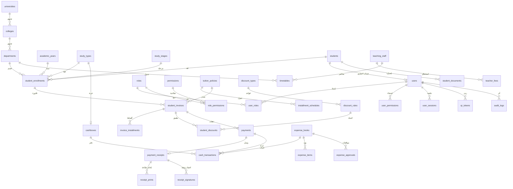

# مخطط العلاقات (ERD)

العلاقات المالية لا تُحذف عند تعطيل المستخدم. الفاتورة لقطة مستقلة عن سياسة القسط الحالية.

## قواعد السلامة

1. لا يُستخدم اسم الطالب كمفتاح.  
2. الرقم الجامعي فريد داخل الكلية.  
3. رقم الوصل فريد عالمياً.  
4. حركة الخزنة إما إيراد دفعة أو صرف كتاب أو تسوية موثّقة.  
5. `audit_logs` للإلحاق فقط من واجهة النظام.
