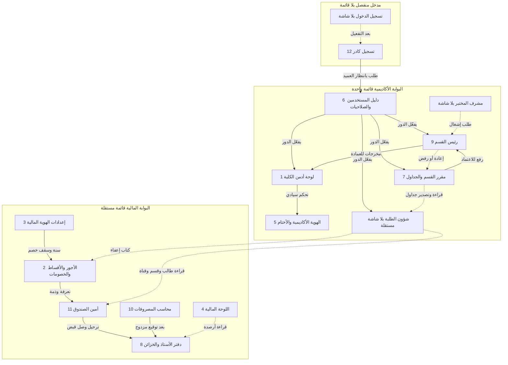

# مخطط ربط البوابة الأكاديمية والمالية

المصدر: 12 شاشة HTML في أرشيف Stitch، بلا قاعدة بيانات منفّذة. الجداول أدناه نموذج منطقي مستخرج من الحقول ومسارات الاعتماد الظاهرة في الواجهات. الأسماء العينة للأقسام تختلف بين الشاشات؛ الكيان الموحّد هو جدول الأقسام.

البوابتان لا تشتركان في قائمة جانبية. الشخص نفسه (العميد) قد يملك ربطين، كل ربط يفتح قشرة واحدة: «عميد الكلية الأكاديمي» أو «عميد الكلية / المشرف المالي».

## ١. الواجهات والاعتماديات

الخط المتصل مسار عمل أو ترحيل. الخط المتقطع قراءة أو إعادة. لا يوجد سهم تنقّل من القائمة الأكاديمية إلى القائمة المالية.

### ماذا تفعل كل شاشة

| مجلد | الواجهة | القشرة | تعتمد على | تُخرج إلى | تبقى خارجها |
| --- | --- | --- | --- | --- | --- |
| `_12` | تسجيل كادر | مدخل | الأدوار والأقسام | مستخدم معلّق في `_6` | لا تمنح صلاحية |
| — | تسجيل الدخول | مدخل | حساب مفعّل | الجلسة حسب الربط | الشاشة غير مرسومة |
| `_1` | أدمن الكلية | أكاديمي | الأقسام والمستخدمون والسنة | بنود القائمة، وأمر النتائج حسب المصفوفة | الخزينة والأجور |
| `_6` | المستخدمون والصلاحيات | أكاديمي | طلبات `_12` | تفعيل الدور و QR | القيود المالية |
| `_5` | الهوية الأكاديمية | أكاديمي | السجل الوزاري | ختم الشهادات والمخاطبات | إعدادات الوصولات في `_3` |
| `_9` | رئيس القسم | أكاديمي | حزمة المقرر وطلب المختبر | اعتماد أو إعادة أو رفض، تعميم، اعتماد الشيت | القبول المركزي والمالي، وخارج قسمه |
| `_7` | مقرر القسم | أكاديمي | إعادة الرئيس، نواقص الوثائق | جدول ثم رفع للاعتماد | تعديل الإضبارة والنتائج النهائية |
| — | شؤون الطلبة | أكاديمي | جداول للقراءة، أمر النتائج | القيد والوثائق | تعديل الدرجات؛ بلا شاشة مستقلة |
| — | مشرف المختبر | أكاديمي | القاعات | طلب إشغال إلى `_9` | خارج مصفوفة `_6` |
| `_4` | اللوحة المالية | مالي | الخزنتان وسجل التدقيق | لا كتابة | اللوحة الأكاديمية |
| `_3` | الإعدادات المالية | مالي | الربط الوزاري | السنة، الإقفال، ختم الوصولات، سقف الخصم | هوية الشهادات في `_5` |
| `_2` | الأجور والخصومات | مالي | الأقسام والقنوات | تعرفة، تقسيط، إعفاء، بتّ التخفيض | القبض النقدي |
| `_11` | أمين الصندوق | مالي | هوية الطالب والذمة والخصم | وصل QR وقيد قبض وإقفال وردية | الصرف وتعديل التعرفة |
| `_10` | محاسب المصروفات | مالي | اسم الخزنة بلا رصيد | سند ثم إرسال للتوقيع | الأرصدة ودفتر اليومية |
| `_8` | دفتر الأستاذ | مالي | وصولات مرحلة وسندات موقّعة | تسوية ومطابقة؛ القيد المرحّل مقفل | الدرجات والجداول |

## ٢. الصلاحيات

مصفوفة البوابة الأكاديمية منقولة من شاشة `_6`. الوحدة المالية محظورة داخل هذه البوابة بنص الفصل (SoD).

| الوحدة | أدمن الكلية | رئيس القسم | مقرر القسم | شؤون الطلبة |
| --- | --- | --- | --- | --- |
| لوحة المؤشرات | وصول كامل | مؤشرات قسمه فقط | إحصائيات الجداول | إحصائيات القبول |
| الجداول والقاعات | اعتماد سيادي نهائي | مصادقة وتعديل القسم | إعداد وإدخال | قراءة وتصدير |
| السجل والإضبارة | تدقيق ومصادقة وثائق | سجلات طلبة قسمه | محظور التعديل | إدارة التسجيل |
| النتائج | إصدار الأمر الجامعي | اعتماد الشيت | تدقيق اللجان | أرشفة وإصدار وثائق |
| الهوية والأختام والصلاحيات | تحكم كامل | غير مصرح | غير مصرح | غير مصرح |
| الخزينة والأجور | محظور | محظور | محظور | محظور |

مشرف المختبر وعضو الهيئة التدريسية ظاهران في الدليل أو استمارة `_12` وليسا في المصفوفة. المعاون العلمي والمعاون الإداري بطاقات قيادة في `_1` و`_5`، وليسا دورين في مبدّل الدخول.

المصفوفة المالية ليست مرسومة في الحزمة. الخلايا التالية من نصوص الشاشات `_4` و`_10` و`_11`: أمين الصندوق مقيد بالقبض والوصولات وإقفال اليوم، ومحاسب المصروفات محجوب عن الأرصدة.

| الوحدة | مدير الحسابات | أمين الصندوق | محاسب المصروفات | المدقق | العميد الآمر بالصرف |
| --- | --- | --- | --- | --- | --- |
| لوحة الخزائن `_4` | كامل | لا | محجوب الرصيد | قراءة | إشراف |
| القبض `_11` | إشراف | قبض ووصل وإقفال | لا | قراءة | لا يقبض |
| الصرف `_10` | مراجعة وتوقيع | لا | تحرير بلا رصيد | تدقيق | مصادقة نهائية |
| الدفتر `_8` | تسوية وترحيل | أثر القبض فقط | لا | قراءة | إشراف |
| الأجور `_2` | إعداد | قراءة للتطبيق | لا | تدقيق | خصم فوق 15% |
| الإعدادات `_3` | ضبط | لا | لا | قراءة السجل | اعتماد الختم |
| الدرجات والجداول | لا تعديل | قراءة هوية الطالب والقناة | لا | لا | لا تعديل |

قالب القائمة المالية مكرر على كل شاشات القشرة. القيد الفعلي هو النص، لا وجود البند في الشريط.

## ٣. قاعدة البيانات مربوطة بالواجهات

أربعة نطاقات. النطاق المالي لا يُمنح لدور أكاديمي. الجسر المسموح مفتاح قراءة: الطالب، القيد، القسم، القناة، وكتاب الإعفاء.

```mermaid
erDiagram
  DEPARTMENTS ||--o{ ENROLLMENTS : "نطاق أكاديمي"
  STUDENTS ||--o{ ENROLLMENTS : قيد
  ENROLLMENTS ||--o{ TIMETABLE_SLOTS : مرحلة
  TIMETABLE_SLOTS ||--o{ TIMETABLE_REQUESTS : اعتماد
  ENROLLMENTS ||--o{ GRADE_SHEETS : سعي
  GRADE_SHEETS ||--o| ACADEMIC_ORDERS : "أمر العميد"
  USERS ||--o{ ROLE_BINDINGS : إسناد
  ROLE_BINDINGS }o--|| DEPARTMENTS : "نطاق القسم"
  DEPARTMENTS ||--o{ FEE_TARIFFS : "تسعير مالي"
  STUDENTS ||--o| STUDENT_ACCOUNTS : "ذمة للقراءة"
  STUDENT_ACCOUNTS ||--o{ RECEIPTS : قبض
  RECEIPTS ||--|| JOURNAL_ENTRIES : ترحيل
  VOUCHERS ||--o| JOURNAL_ENTRIES : "بعد توقيعين"
  JOURNAL_ENTRIES }o--|| VAULTS : خزنة
  INSTITUTIONS ||--o{ BRAND_ASSETS : "نطاق شهادات أو وصولات"
```

`BRAND_ASSETS.scope` يفصل كتابة شاشة `_5` (شهادات ومخاطبات) عن كتابة شاشة `_3` (وصولات وسندات). `VOUCHERS.department_id` اسم مستفيد فقط ولا يفتح سجلات القسم.

القيود المرحلة في `JOURNAL_ENTRIES` وسجل `AUDIT_EVENTS` إلحاقية: الشاشات تعرضها بلا تعديل ولا حذف.
